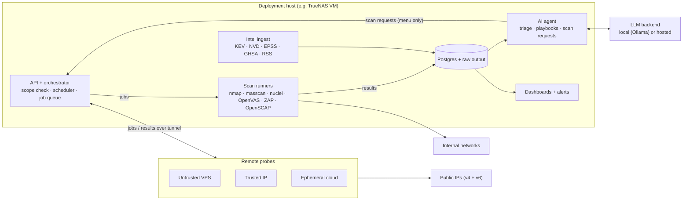

# pen15 architecture

pen15 is a scan pipeline with a history store at its center. Deterministic tools do the scanning, a normalized store turns their output into diffs, and an AI agent reads that history to triage and plan. The agent never touches the network directly. Requirements live in [SPEC.md](SPEC.md); technology choices are justified in [docs/stack.md](docs/stack.md).

## Overview



## Components

### API and orchestrator

One Python service and the only component with authority to start scans. It:

- Exposes the HTTP API (FR-26 to FR-28), authenticated with scoped tokens.
- Loads the deployment's scope, schedules and labels.
- Resolves every job's targets and rejects anything outside scope (FR-1), including requests from the agent.
- Runs the DDNS self-check before external jobs (FR-2).
- Enqueues jobs in Postgres (`SELECT … FOR UPDATE SKIP LOCKED`) and dispatches them to local runners or remote probes.
- Parses results through ingester plugins and computes diff events after each run.

### Scan runners

Each tool runs in its own container image, launched per job by the orchestrator with only the capabilities it needs (`NET_RAW`/`NET_ADMIN` for raw-socket scanners). Runners receive targets and options, write raw output to a job directory, and exit. They hold no database credentials. Greenbone runs as a long-lived service the orchestrator drives through its API.

### Remote probes

A probe is a small agent plus the same runner images, on a host outside the network. It:

- Connects to the orchestrator over a private tunnel (Tailscale in the reference deployment), with network ACLs allowing it to reach only the orchestrator's probe endpoint.
- Pulls jobs, which are signed by the orchestrator and verified by the probe.
- Only accepts targets in the deployment's public scope, re-checked locally as defense in depth.
- Uploads raw results tagged with its vantage id.
- Holds no LAN credentials and cannot initiate connections into the internal network.

### Store

Postgres holds the normalized model; raw tool output is kept compressed on disk, keyed by job id (FR-14). pgvector stores embeddings of triage decisions and findings for agent retrieval.

### Intel ingest

A scheduled job pulls each intel source, dedupes by CVE id, and writes `intel_item` rows. A matcher compares items to `service` rows by CPE and version range. LLM-assisted fuzzy matches are stored separately and flagged.

### AI agent

A batch process, run after each scan cycle and daily for intel, that:

1. Reads new diff events, findings and intel matches, with asset context and retrieved past decisions.
2. Writes a ranked triage report and, for findings the operator escalates, a playbook (FR-19).
3. Optionally emits follow-up scan requests from the allowed-action menu, submitted to the API with an `agent`-scoped token like any other client.

It talks to an LLM through an OpenAI-compatible interface, so local and hosted backends are interchangeable. An optional pseudonymizer swaps IPs and hostnames for stable tokens before hosted calls and reverses them in the response.

### Dashboards and alerts

Grafana reads Postgres directly for timelines and severity trends. Notifier plugins send diff events above the alert threshold, plus the daily and weekly digests.

## Data model

| Table | Holds | Key |
| --- | --- | --- |
| `asset` | Host identity, labels, network, first/last seen | MAC where known, else stable id |
| `service` | Asset + protocol + port, banner, product, version, CPE | (asset, proto, port) |
| `scan_run` | Tool, vantage, scope, requester, status, timings | id |
| `observation` | Every sighting of a service or finding in a run | (run, subject) |
| `finding` | Deduped issue, severity, lifecycle state, evidence | fingerprint of (asset, service, check id) |
| `compliance_result` | Rule × asset × pass/fail per run, profile | (run, asset, rule) |
| `diff_event` | Typed change computed after a run | id, run |
| `intel_item` | CVE/advisory/news item, KEV/EPSS data | source + external id |
| `intel_match` | Intel item ↔ service, match method, confidence | (item, service) |
| `playbook` | Analysis, mitigations, manual tests, results | finding |
| `decision` | Operator triage actions and reasons (embedded) | id |

## Job lifecycle

1. A schedule, API client or agent requests a job: `{plugin, targets, profile, requester, reason}`.
2. The orchestrator expands targets, enforces scope and exclusions, and runs the DDNS check for external jobs. A rejected job is logged with the reason.
3. The job is queued and dispatched to a local runner or a probe.
4. Raw output is stored, then parsed by the plugin's ingester into observations.
5. The orchestrator updates assets, services, findings and compliance results, and computes diff events.
6. Notifiers fire for events above the threshold; the agent picks up events on its next run.

Results pushed through `/ingest` enter at step 4.

## Plugin interfaces

Plugins are Python packages discovered via entry points, so a deployment can add its own without forking.

| Kind | Contract |
| --- | --- |
| `runner` | `build_job(targets, profile) -> ContainerSpec`; declares capabilities it needs |
| `ingester` | `parse(raw: Path) -> Iterable[Observation]`; declares the formats it accepts |
| `notifier` | `send(event | digest)` |
| `intel_source` | `fetch(since) -> Iterable[IntelItem]` |
| `llm_backend` | OpenAI-compatible chat + embeddings |
| `agent_action` | A named, parameterized follow-up the agent may request; maps to a runner job |

## Repository and deployment split

The core repo (this one) contains the engine, built-in plugins, container images and an example deployment. Each real deployment lives in its own repo, usually private, and pins a released core image.

```
pen15/                      # public core
  src/pen15/                # orchestrator, API, models, diff engine, agent
  plugins/                  # built-in runners, ingesters, notifiers, intel sources
  images/                   # runner and probe Dockerfiles
  examples/deployment/      # template for a deployment repo
  docs/

<deployment>/               # private, per network
  pen15.yaml                # core image version, enabled plugins, LLM backend
  scope.yaml                # internal and public scope, exclusions, DDNS name
  schedules.yaml
  labels.yaml               # asset labels and notes
  secrets.enc.yaml          # sops + age encrypted
  compose.override.yaml     # host-specific networking (macvlan, VLAN interfaces)
  plugins/                  # optional deployment-only plugins
```

## Security model

- **Scope is enforced in one place**, the orchestrator, before dispatch, and re-checked on probes.
- **No public listener.** The API and UI bind to the LAN or the tunnel only.
- **Least privilege:** runners get only the capabilities they need and no database access; the agent gets an `agent` token that can only request menu actions; probes get a `probe` token and tunnel ACLs.
- **Secrets** are encrypted at rest in the deployment repo (sops + age) and decrypted at startup on the host. The age key never enters git.
- **The agent has no shell, no network access and no write access** to findings beyond its own reports and requests.
- **Supply chain:** runner images are pinned by digest, and nuclei template signature verification is enforced.
