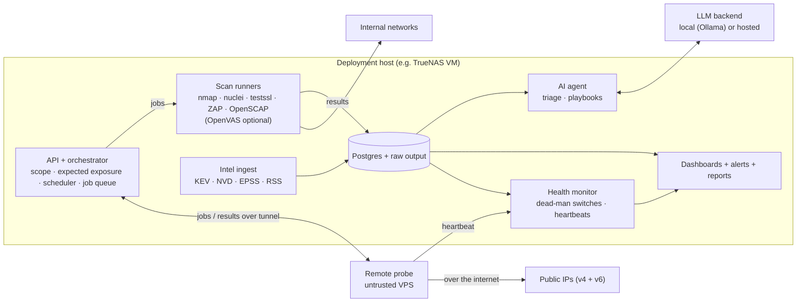

# pen15 architecture

pen15 is a scan pipeline with a history store at its center. Deterministic tools do the scanning, a normalized store turns their output into diffs and checks it against declared intent, and an AI agent reads that history to triage and write playbooks. The agent never touches the network directly. Requirements live in [SPEC.md](SPEC.md); technology choices are justified in [docs/stack.md](docs/stack.md).

## Overview



## Components

### API and orchestrator

One Python service and the only component with authority to start scans. It:

- Exposes the HTTP API (FR-37 to FR-39), authenticated with scoped tokens.
- Loads the deployment's scope, expected exposure, schedules and labels.
- Resolves every job's targets and rejects anything outside scope (FR-1).
- Runs the DDNS self-check before external jobs (FR-2).
- Enqueues jobs in Postgres (`SELECT … FOR UPDATE SKIP LOCKED`) and dispatches them to local runners or the remote probe.
- Parses results through ingester plugins, resolves asset identity, computes diff events, and evaluates every observed service against the expected-exposure declaration (FR-5, FR-17).

### Scan runners

Each tool runs in its own container image, launched per job by the orchestrator with only the capabilities it needs (`NET_RAW`/`NET_ADMIN` for raw-socket scanners). Runners receive targets and options, write raw output to a job directory, and exit. They hold no database credentials.

OpenVAS is an optional plugin. When enabled, Greenbone runs as a long-lived service the orchestrator drives through its API.

OpenSCAP runs in push mode by default: each host runs `oscap` on a timer and posts results to `/ingest`, so the scanner holds no keys to the host. Pull mode over SSH uses a dedicated low-privilege account with a key restricted by forced command and source address (FR-15).

### Remote probe

A probe is a small agent plus the same runner images, on a host outside the network. It:

- Connects to the orchestrator over a private tunnel (Tailscale in the reference deployment), with network ACLs allowing it to reach only the orchestrator's probe endpoint.
- Pulls jobs, which are signed by the orchestrator and verified by the probe.
- Only accepts targets in the deployment's public scope, re-checked locally as defense in depth.
- Scans public targets over its own internet connection. It must not use an exit node or subnet route, or the external scan would silently become an internal one (FR-12).
- Uploads raw results tagged with its vantage id, and sends heartbeats.
- Holds no LAN credentials and cannot initiate connections into the internal network.

v1 uses one untrusted probe. More vantages are the same component with a different vantage id.

### Asset identity

An asset is resolved from a composite of MAC, hostname, DHCP fingerprint and mDNS name (FR-8). MACs with the locally administered bit set are treated as randomized and weighted down, so a phone rotating its MAC matches its existing asset instead of creating a new one. IPv4 and IPv6 addresses are attributes of an asset with first and last seen times. Each asset has a device class (for example `linux`, `macos`, `ios`, `iot`), set from labels or inferred from fingerprinting, which decides which checks apply to it.

### Store

Postgres holds the normalized model. Raw tool output is kept compressed on disk, keyed by job id, with a retention period (FR-19). Schema changes ship as Alembic migrations (FR-42). Backup covers the database and raw output, with a documented restore test (FR-43).

### Intel ingest

A scheduled job pulls each intel source, dedupes by CVE id, and writes `intel_item` rows. A matcher compares items to `service` rows by CPE and version range. Only CVE-backed matches can trigger checks (FR-21, FR-22). News items are attached to the digest; the agent may suggest related assets, labeled as suggestions (FR-23).

### AI agent

A batch process, run after each scan cycle and daily for intel, that:

1. Reads new diff events, findings and intel matches, with asset context and the operator's relevant recent decisions.
2. Writes a ranked triage report and, for findings the operator escalates, a playbook (FR-25).

Inputs are split by trust. Structured fields the store controls (severity, CVE, port, asset labels) are passed as data. Scan-derived text (banners, HTTP titles, certificate fields, news text) is passed as quoted data with its provenance, and the prompt says it is never instructions (FR-26).

Outputs are recommendations only. The agent cannot close, suppress or accept a finding, and a ranking can't push a finding below its deterministic severity floor (FR-27). Operator decisions are applied by deterministic suppression rules, not by the model (FR-28).

The agent talks to an LLM through an OpenAI-compatible interface, so local and hosted backends are interchangeable. In strict-privacy mode it waits for the local backend instead of falling back (FR-29).

An evaluation set of labeled past findings is run whenever the model or prompts change, tracking the false-dismiss rate (FR-30).

Follow-up scan requests, where the agent picks an action from a fixed menu, are a phase 5 extension behind a config flag.

### Health monitor

Every schedule has an expected window. The monitor alerts when a run doesn't complete within it after N consecutive misses, when the DDNS check keeps skipping external jobs, or when a probe heartbeat goes missing (FR-34, FR-35). The dashboard shows the last successful run for each scan type and vantage (FR-36). Health alerts go through the same notifiers, with their own severity, so they can't be filtered out with ordinary findings.

### Dashboards, alerts and reports

Grafana reads Postgres directly for timelines and severity trends. Notifier plugins send diff events above the alert threshold, plus the daily and weekly digests. Remediation metrics are SQL views over `finding` and `observation` history, so the dashboard and the emailed remediation report read the same numbers (FR-33). The composite risk score's formula is documented, and the score is shown beside the counts it is built from. The report renders HTML with static chart images and is sent through the email notifier.

## Data model

| Table | Holds | Key |
| --- | --- | --- |
| `asset` | Composite identity, device class, labels, network, first/last seen | stable id |
| `asset_address` | IPv4/IPv6 and MAC addresses per asset, randomized flag | (asset, address) |
| `service` | Asset + protocol + port, banner, product, version, CPE | (asset, proto, port) |
| `expected_exposure` | Declared services per host and per vantage, loaded from the deployment | (asset or label, proto, port, vantage) |
| `scan_run` | Tool, vantage, scope, requester, status, timings | id |
| `observation` | Every sighting of a service or finding in a run | (run, subject) |
| `finding` | Deduped issue, kind (vulnerability, compliance, unexpected exposure), severity and floor, lifecycle state, evidence | fingerprint of (asset, service, check id) |
| `compliance_result` | Rule × asset × pass/fail per run, profile | (run, asset, rule) |
| `diff_event` | Typed change computed after a run | id, run |
| `intel_item` | CVE or news item, KEV/EPSS data | source + external id |
| `intel_match` | Intel item ↔ service, match method, confidence | (item, service) |
| `playbook` | Analysis, mitigations, manual tests, results | finding |
| `decision` | Operator triage actions, reasons and suppression rules | id |
| `health_check` | Expected window and last success per schedule and probe | schedule or probe |

## Job lifecycle

1. A schedule or API client requests a job: `{plugin, targets, profile, requester, reason}`.
2. The orchestrator expands targets, enforces scope and exclusions, and runs the DDNS check for external jobs. A rejected or skipped job is logged with the reason and counted by the health monitor.
3. The job is queued and dispatched to a local runner or the probe.
4. Raw output is stored, then parsed by the plugin's ingester into observations.
5. The orchestrator resolves assets, updates services, findings and compliance results, computes diff events, and evaluates expected exposure.
6. The health monitor records the run. Notifiers fire for events above the threshold. The agent picks up events on its next run.

Results pushed through `/ingest` enter at step 4.

## Plugin interfaces

Plugins are Python packages discovered via entry points, so a deployment can add its own without forking.

| Kind | Contract |
| --- | --- |
| `runner` | `build_job(targets, profile) -> ContainerSpec`; declares capabilities it needs |
| `ingester` | `parse(raw: Path) -> Iterable[Observation]`; declares the formats it accepts |
| `notifier` | `send(event | digest)` |
| `intel_source` | `fetch(since) -> Iterable[IntelItem]` |
| `exposure_source` | `fetch() -> Iterable[ForwardRule]`; imports router or firewall port forwards (FR-6) |
| `llm_backend` | OpenAI-compatible chat |

## Repository and deployment split

The core repo (this one) contains the engine, built-in plugins, container images, the test lab and an example deployment. Each real deployment lives in its own repo, usually private, and pins a released core image. `pen15 validate` checks a deployment repo against the schema of the pinned version (FR-41).

Deployment is done with Ansible. The core ships a `pen15.deploy` collection with three roles: `server` (Docker, compose stack, systemd, age key placement), `probe` (Tailscale with a probe tag, probe container, heartbeat) and `oscap_agent` (OpenSCAP push timer and ingest token on scanned hosts). The deployment repo holds `site.yml`, the inventory and group vars, and reads secrets from the same sops file through the `community.sops` lookup. The VM or VPS itself is created by hand or with the provider's tooling; Ansible starts at the OS. The `server` and `probe` roles target Debian stable (13 "trixie"); scanned hosts running `oscap_agent` can be any distribution with SCAP Security Guide content.

```
pen15/                      # public core
  src/pen15/                # orchestrator, API, models, diff engine, agent, health
  plugins/                  # built-in runners, ingesters, notifiers, intel sources
  images/                   # runner and probe Dockerfiles
  ansible/                  # pen15.deploy collection: server, probe, oscap_agent roles
  migrations/               # Alembic
  lab/                      # isolated vulnerable targets for tests and demos
  tests/fixtures/           # real tool output for parser and diff tests
  examples/deployment/      # template for a deployment repo
  docs/

<deployment>/               # private, per network
  pen15.yaml                # core image version, enabled plugins, LLM backend
  scope.yaml                # internal and public scope, exclusions, DDNS name
  exposure.yaml             # expected services per host, and what is public
  schedules.yaml
  labels.yaml               # asset labels and notes
  secrets.enc.yaml          # sops + age encrypted
  compose.override.yaml     # host-specific networking (macvlan, VLAN interfaces)
  site.yml                  # Ansible entry point
  inventory/                # scanner VM, probe, OpenSCAP push hosts
  group_vars/
  requirements.yml          # pins pen15.deploy to the deployment's version
  plugins/                  # optional deployment-only plugins
```

## Testing

- **Fixtures:** recorded output from every supported tool and version, used by parser and diff tests.
- **Lab:** a compose file that starts intentionally vulnerable targets (for example DVWA, OWASP Juice Shop and an outdated OpenSSH) on an isolated Docker network with no route out. CI runs a full scan, diff, exposure check and report cycle against it (NFR-6). The lab doubles as the public demo.
- **Agent evaluation:** a labeled set of findings, including prompt-injection cases planted in banners and HTTP titles in the lab, run when the model or prompts change.

## Security model

- **Scope is enforced in one place**, the orchestrator, before dispatch, and re-checked on probes.
- **No public listener.** The API and UI bind to the LAN or the tunnel only.
- **Least privilege:** runners get only the capabilities they need and no database access; the agent gets an `agent` token with read access and write access to its own reports only; probes get a `probe` token and tunnel ACLs.
- **Credential custody:** OpenSCAP push mode by default; any scan accounts are dedicated, low-privilege and key-restricted; credentials live only in encrypted secrets.
- **Untrusted input to the LLM:** scan-derived text is quoted data with provenance, the agent's outputs are recommendations only, and severity floors are deterministic.
- **Secrets** are encrypted at rest in the deployment repo (sops + age) and decrypted at startup on the host. The age key never enters git.
- **Supply chain:** runner images are pinned by digest, and nuclei template signature verification is enforced.
- **Silence is a failure:** missing runs and heartbeats alert, so a broken scanner can't look like a clean network.
