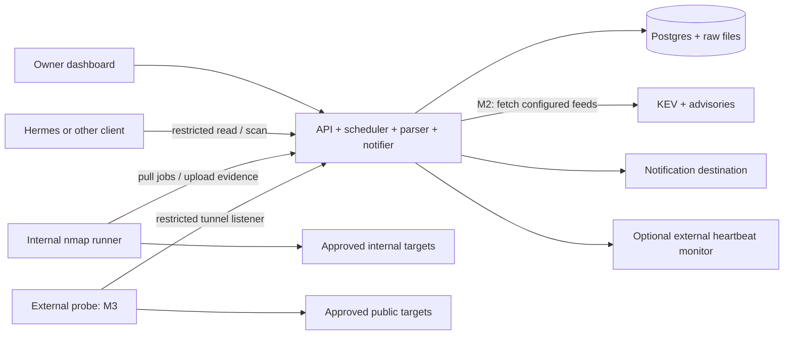

# Architecture

This is the intended design. Only documentation and branding exist today. [PLAN.md](PLAN.md) stages delivery; [contracts.md](contracts.md) defines evidence and execution, and [SECURITY.md](SECURITY.md) defines trust boundaries.

## Small core



One Python service provides a FastAPI API, server-rendered dashboard, scheduler, result normalization, advisory matching, and notification delivery. These are internal modules, not separate services or a public plugin framework. Postgres holds inventory, settings, intent, observations, jobs, findings, audit history, and a durable outbox. Compressed evidence lives in immutable files named by digest.

One long-lived pinned nmap container pulls assigned jobs from a dedicated runner listener. It has `NET_RAW`, no other capabilities, no database credentials, and no container-runtime socket. It runs one job at a time. Host deployment machinery installs network policy before the runner can execute; the API cannot rewrite host firewall rules. The external probe reuses this protocol and has its own identity and vantage.

## Dashboard and API

The dashboard is the primary interface. It reads and mutates through the same application services as the versioned API; HTML responses need no separate SPA. [UX.md](UX.md) defines the views and controls.

| API capability | Initial use |
| --- | --- |
| Read health, assets, services, findings, changes, jobs, and later advisories | Dashboard and resource-restricted `read` clients |
| Request a scan or targeted verification; inspect or cancel owned requests | Owner and resource/profile-restricted `scan` clients |
| Manage intent, product labels, decisions, schedules, and alert preferences | Authenticated owner session only |
| Pull assignments, upload assigned results, report heartbeat | Enrolled `runner` identity on the dedicated listener only |

A client can hold combined read/scan permissions. An assistant such as Hermes uses the API schema and a restricted token; pen15 does not run the assistant or give it a shell. A restricted scan request selects one registered asset, an approved profile, and a reason. It cannot supply command arguments, arbitrary URLs, scope additions, or finding decisions. Shared scan budgets, coalescing, and request limits prevent an assistant from bypassing schedules or flooding the runner. See [SECURITY.md](SECURITY.md).

Future remediation needs a separate permission and action contract. No execution endpoint, remediation credentials, or general action engine ships in v1.

## Evidence flow

1. A schedule, owner, or restricted API client requests work. Snapshot the authorized targets, bindings, profile, vantage, configuration revision, and deadline.
2. Split it into bounded jobs. Validate scope at dispatch. The assigned runner receives its current attempt over authenticated TLS and checks identity, expiry, scope, and fixed options.
3. Store bounded raw output durably, then parse locally with external resource loading disabled. Retain explicit positive, negative, unavailable, and failed coverage.
4. In one database transaction, update observations, derived findings, transitions, and outbox events. Old or duplicate attempts cannot override current evidence.
5. Deliver grouped notifications with retries. Update dashboard freshness independently of finding counts.

Transport authentication and resource-bound assignments are sufficient for v1; there is no separate job-signing/key-rotation system. Local deadlines still apply when the runner loses contact. Only one active job is allowed per runner and per asset/vantage.

## Inventory and intelligence

Known assets have owner-chosen IDs and explicit address/identity bindings. Unknown devices receive provisional IDs. Conservative matching and owner corrections avoid a general identity-resolution engine. A product label can be entered once for a service or watchlist entry when a banner is unhelpful; it retains its source and observation date.

M2 fetches KEV and a small set of owner-selected advisory feeds. Match structured product identifiers and explicit aliases, retain affected-version evidence, and label incomplete matches as potentially affected. Unmatched disclosures remain browsable. An optional NVD adapter supplements this; missing enrichment cannot mean unaffected. Feed content never becomes instructions or a scan target.

No built-in model, vector store, vulnerability scanner fleet, compliance agent, or analytical database is required. Internal parser, tool, notifier, and feed interfaces can grow when there is a working second use case.

## Deployment and state ownership

The reference host is an existing Debian 13 VM with Docker. The core supplies Compose and a `pen15.deploy` Ansible collection with `server` and, in M3, `probe` roles. Ansible owns host interfaces, egress policy, service startup, private TLS, runtime secret files, and backup timers. The owner provisions the VM/VPS separately.

| State | Authority |
| --- | --- |
| Scope, exclusions, host networking, permitted profile ceilings, secret references, release pins | Private deployment repository, applied by Ansible |
| Asset declarations, expected exposure, product labels/watchlist, schedules and notification preferences | Database; edited in dashboard and included in the settings export |
| Observations, findings, decisions, enrollment credentials, and audit history | Database backup; never overwritten by a settings import |

Scope/ceiling changes are rare deployment operations. Routine settings can be changed within those ceilings without a deployment. Applying a deployment never reloads old exported intent over UI changes.

```text
<deployment>/
  pen15.yaml            # release, networks, scope, exclusions, safety ceilings
  settings-export/      # optional versioned assets.yaml, exposure.yaml, settings.yaml bundle
  secrets.enc.yaml      # sops + age; decrypted only on the Ansible controller
  compose.override.yaml # host-specific interfaces/mounts
  site.yml
  inventory/
  requirements.yml      # pinned deployment collection
```

Exports are optional portability artifacts, not a second live source of truth. Backups recover current state without requiring Git synchronization. [operations.md](operations.md) covers restart, restore, and upgrades.
