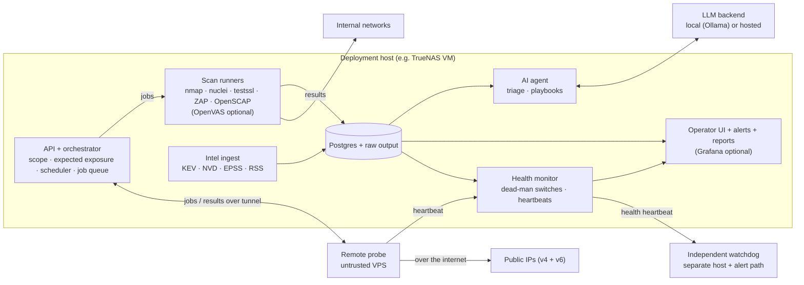

# pen15 architecture

pen15 is a scan pipeline with a history store at its center. Deterministic tools do the scanning, a normalized store turns their output into diffs and checks it against declared intent, and an AI agent reads that history to triage and write playbooks. The agent never touches the network directly. Requirements live in [SPEC.md](SPEC.md); technology choices are justified in [stack.md](stack.md).

This is the intended architecture, not a description of shipped code. [PLAN.md](PLAN.md) stages delivery; AI, compliance, and Grafana are optional later components. [contracts.md](contracts.md) defines state/identity/execution semantics, [SECURITY.md](SECURITY.md) defines trust boundaries, and [operations.md](operations.md) defines failure/recovery behavior.

## Overview



## Components

### API and orchestrator

One Python service and the only component with authority to start scans. It:

- Exposes the HTTP API (FR-37 to FR-39), authenticated with scoped tokens.
- Serves the owner UI with authenticated sessions and CSRF protection; core decisions use the same services as API mutations.
- Loads the deployment's scope, expected exposure, schedules and labels.
- Resolves every job's targets and rejects anything outside scope (FR-1).
- Runs the DDNS self-check before external jobs (FR-2).
- Enqueues jobs in Postgres (`SELECT … FOR UPDATE SKIP LOCKED`) and dispatches them to local runners or the remote probe.
- Parses results through ingester plugins, resolves asset identity, computes diff events, and evaluates every observed service against the expected-exposure declaration (FR-5, FR-17).
- Validates and atomically activates configuration revisions. Expected-exposure changes are exported as patches for the owner to commit/deploy; the application has no Git write credentials.

### Scan runners

Each tool runs in its own pinned container image. The orchestrator requests execution through a restricted local launcher; the browser-facing API does not have a raw container-runtime socket. The launcher enforces approved images, mounts, capabilities, per-job target egress, resource limits, and deadlines. Runners receive validated manifests/options, write bounded raw output to a job directory, and exit. They hold no database credentials. Privileges such as `NET_RAW` require an approved profile and isolation test.

OpenVAS is an optional plugin. When enabled, Greenbone runs as a long-lived service the orchestrator drives through its API.

OpenSCAP, when introduced in M5, runs in push mode by default: each host runs `oscap` on a timer and posts results to `/api/v1/ingest`, so the scanner holds no keys to the host. Pull mode over SSH uses a dedicated low-privilege account with a key restricted by forced command and source address (FR-15).

### Remote probe

A probe is a small agent plus the same runner images, on a host outside the network. It:

- Connects to the orchestrator over a private tunnel (Tailscale in the reference deployment), with network ACLs allowing it to reach only the orchestrator's probe endpoint.
- Pulls signed jobs bound to its identity, attempt, target manifest, nonce, configuration revision, and expiry. The probe checks replay and enforces local deadlines even without a connection to the server.
- Only accepts targets in the deployment's public scope, re-checked locally as defense in depth.
- Scans public targets over its own internet connection. It must not use an exit node or subnet route, or the external scan would silently become an internal one (FR-12).
- Uploads raw results tagged with its vantage id, and sends heartbeats.
- Holds no LAN credentials and can reach only its permitted probe API endpoints over the tunnel; no other LAN services are reachable.

v1 uses one untrusted probe. More vantages are the same component with a different vantage id.

### Asset identity

Assets have stable IDs with time-bounded address bindings. Resolution uses available MAC, hostname, authenticated identity, DHCP and mDNS evidence (FR-8). Locally administered MACs are weak evidence; continuity is not assumed. The initial resolver automatically associates only unambiguous stable identifiers, and surfaces ambiguous matches for owner review. Merge/split actions retain original evidence and an audit trail. Device classes can select supported check profiles in M2, without treating inferred class as confirmed identity. Detailed rules live in [contracts.md](contracts.md).

### Store

Postgres holds the normalized model, job leases, append-only state history, and durable notification outbox. Compressed raw output is stored by run/attempt/digest with retention and disk-pressure limits (FR-19). Store raw evidence durably before atomically finalizing observations, coverage, findings, and outbox events. Schema changes ship as Alembic migrations (FR-42). Backup includes a consistent database snapshot, referenced evidence, and configuration/release manifest with a demonstrated restore (FR-43).

### Intel ingest

A scheduled job pulls each intel source, dedupes by CVE id, and writes `intel_item` rows. A matcher compares items to `service` rows by CPE and version range. Only CVE-backed matches can trigger checks (FR-21, FR-22). News items are attached to the digest; the agent may suggest related assets, labeled as suggestions (FR-23).

### AI agent

A batch process, run after each scan cycle and daily for intel, that:

1. Reads new diff events, findings and intel matches, with asset context and the operator's relevant recent decisions.
2. Writes a ranked triage report and, for findings the operator escalates, a playbook (FR-25).

Inputs are split by trust. Structured fields the store controls (severity, CVE, port, asset labels) are passed as data. Scan-derived text (banners, HTTP titles, certificate fields, news text) is passed as quoted data with its provenance, and the prompt says it is never instructions (FR-26).

Outputs are recommendations only. The agent cannot close, suppress or accept a finding, and a ranking can't push a finding below its deterministic severity floor (FR-27). Operator decisions are applied by deterministic suppression rules, not by the model (FR-28).

The optional agent uses a provider adapter with an OpenAI-compatible internal interface. Local inference is the default. Hosted use/fallback requires explicit permitted fields, destination, and spending cap; strict-privacy mode prohibits hosted fallback (FR-29). Provider-specific translation belongs in the adapter. Model failure does not affect deterministic monitoring or operator actions.

An evaluation set of labeled past findings is run whenever the model or prompts change, tracking the false-dismiss rate (FR-30).

Follow-up scan requests are an M7 extension requiring a separately specified capability and approved fixed action menu before its config flag can be enabled.

### Health monitor

Every schedule has an expected window. The monitor alerts when a run doesn't complete within it after N consecutive misses, when the DDNS check keeps skipping external jobs, or when a probe heartbeat goes missing (FR-34, FR-35). The dashboard shows the last successful run for each scan type and vantage (FR-36). Health alerts go through the same notifiers, with their own severity, so they can't be filtered out with ordinary findings.

An outbound health heartbeat also checks database, scheduler, and notification-outbox health. An independent watchdog on a separate host uses its own alert path to detect missing/unhealthy heartbeats, including total scanner-host loss. Without it, the UI states that this outage cannot be self-detected. See [operations.md](operations.md) for thresholds and delivery failure behavior.

### Dashboards, alerts and reports

The initial server-rendered operator UI covers setup status, findings/evidence, decisions, configuration patch export, and verification; [UX.md](UX.md) defines the flows and failure states. Notifiers consume a durable outbox with grouped events, bounded retry, delivery status, and daily/weekly digests as their features arrive.

Optional Grafana dashboards use a read-only database role restricted to versioned reporting views. The UI/reporting services and emailed reports use the same metric definitions from retained finding history (FR-33). A later composite score must show its formula, counts, policy version, and coverage freshness. HTML email/static charts and Grafana do not become prerequisites for core decisions.

## Data model

| Table | Holds | Key |
| --- | --- | --- |
| `asset` | Composite identity, device class, labels, network, first/last seen | stable id |
| `asset_address` | Time-bounded IPv4/IPv6/MAC bindings, network context and identity confidence | binding id |
| `service` | Asset + protocol + port, banner, product, version, CPE | (asset, proto, port) |
| `expected_exposure` | Declared services per asset and vantage, loaded from an activated revision | (revision, asset, proto, port, vantage) |
| `scan_run` | Logical job, immutable target/config/profile manifest, vantage, requester, status, timings | id |
| `scan_attempt` | Lease/fencing token, execution deadline, runner, image/parser versions, output digest | (run, attempt) |
| `coverage` | Outcome for a target/service/check/vantage/address binding; completeness and method | (attempt, coverage item) |
| `observation` | Immutable observed/received times, subject, source and evidence reference | id, unique source record per interpretation |
| `finding` | Kind, severity/floor, workflow and decision states, resolution reason, evidence | fingerprint of (asset, service key, canonical check id, vantage) |
| `finding_transition` | Append-only prior/new state, actor, reason, evidence, revision | id, finding |
| `compliance_result` | Rule × asset × pass/fail per run, profile | (run, asset, rule) |
| `diff_event` | Typed change computed after a run | id, run |
| `intel_item` | CVE or news item, KEV/EPSS data | source + external id |
| `intel_match` | Intel item ↔ service, match method, confidence | (item, service) |
| `playbook` | Analysis, mitigations, manual tests, results | finding |
| `decision` | Operator, precise scope, reason, start/expiry, invalidation, revision | id |
| `health_check` | Expected window and last success per schedule and probe | schedule or probe |
| `configuration_revision` | Validated content hash, optional Git revision, activation time | content hash |
| `notification_outbox` | Event/destination key, status, retries, delivery outcome | (event, destination) |

This is a logical model; migrations define physical constraints. [contracts.md](contracts.md) governs coverage aggregation, identity corrections, uniqueness, ordering, and retained history. Label-based declarations remain deferred until their matching and conflict rules are specified.

## Job lifecycle

1. A schedule or API client requests a job: `{plugin, targets, profile, requester, reason}`.
2. The orchestrator expands targets, enforces scope and exclusions, and runs the DDNS check for external jobs. A rejected or skipped job is logged with the reason and counted by the health monitor.
3. A worker claims a bounded lease/fencing token and dispatches the validated manifest to the restricted launcher or assigned probe. Retries cannot blindly overlap an old runner.
4. Raw output is durably stored and deduplicated, then parsed under resource limits into observations and explicit coverage outcomes.
5. The orchestrator atomically resolves assets, updates coverage/services/findings, records transitions/diffs, evaluates expected exposure, and creates outbox entries. Older results cannot overwrite newer state; incomplete coverage cannot imply a fix.
6. Health records success/partial/failure. Notifiers deliver/retry outbox events. The optional agent reads new events independently.

Results pushed through `/api/v1/ingest` enter at step 4 after format, producer, enrolled-asset and size validation. See [contracts.md](contracts.md) for idempotency, leases, cancellation, and replay semantics.

## Plugin interfaces

Plugins are Python packages discovered via entry points, so a deployment can add its own without forking.

| Kind | Contract |
| --- | --- |
| `runner` | `build_job(manifest, profile) -> ContainerSpec`; declares capabilities, limits and supported coverage; launcher validates spec |
| `ingester` | `parse(raw: Path, manifest) -> ParseResult`; contains observations, coverage, errors and parser version; declares accepted formats/versions |
| `notifier` | `send(event_or_digest, delivery_key) -> DeliveryResult`; bounded timeout and retry classification |
| `intel_source` | `fetch(since) -> Iterable[IntelItem]` |
| `exposure_source` | `fetch() -> Iterable[ForwardRule]`; imports router or firewall port forwards (FR-6) |
| `llm_backend` | Provider adapter with OpenAI-compatible internal messages, structured output, data policy and cost limits |

Interfaces are versioned and outputs validated. Plugins cannot mutate core tables or bypass job policy; administrator-installed in-process plugins are trusted code, not sandboxed extensions.

## Repository and deployment split

The planned core repo contains the engine, built-in plugins, container images, test lab and a fictional example deployment. Only documentation/assets exist today. Each real deployment lives in its own repo, usually private, and pins a released core image. `pen15 validate` will check deployment configuration against the pinned version's schema (FR-41), without initiating scans. Core Compose uses opt-in profiles and a deployment-specific override.

Deployment is done with Ansible. The core ships a `pen15.deploy` collection with three roles: `server` (Docker, compose stack, systemd, age key placement), `probe` (Tailscale with a probe tag, probe container, heartbeat) and `oscap_agent` (OpenSCAP push timer and ingest token on scanned hosts). The deployment repo holds `site.yml`, the inventory and group vars, and reads secrets from the same sops file through the `community.sops` lookup. The VM or VPS itself is created by hand or with the provider's tooling; Ansible starts at the OS. The `server` and `probe` roles target Debian stable (13 "trixie"); scanned hosts running `oscap_agent` can be any distribution with SCAP Security Guide content.

```
pen15/                      # public core
  src/pen15/                # orchestrator, API, models, diff engine, agent, health
  plugins/                  # built-in runners, ingesters, notifiers, intel sources
  images/                   # runner and probe Dockerfiles
  ansible/                  # pen15.deploy collection: server, probe, oscap_agent roles
  migrations/               # Alembic
  lab/                      # isolated vulnerable targets for tests and demos
  tests/fixtures/           # real tool output for parser and diff tests
  examples/deployment/      # template for a deployment repo
  docs/

<deployment>/               # private, per network
  pen15.yaml                # core image version, enabled plugins, LLM backend
  scope.yaml                # internal and public scope, exclusions, DDNS name
  exposure.yaml             # expected services per host, and what is public
  schedules.yaml
  labels.yaml               # asset labels and notes
  secrets.enc.yaml          # sops + age encrypted
  compose.override.yaml     # host-specific networking (macvlan, VLAN interfaces)
  site.yml                  # Ansible entry point
  inventory/                # scanner VM, probe, OpenSCAP push hosts
  group_vars/
  requirements.yml          # pins pen15.deploy to the deployment's version
  plugins/                  # optional deployment-only plugins
```

## Testing

- **Fixtures:** recorded output from every supported tool and version, used by parser and diff tests.
- **Lab:** a compose file that starts intentionally vulnerable targets (for example DVWA, OWASP Juice Shop and an outdated OpenSSH) on an isolated Docker network with no route out. CI runs a full scan, diff, exposure check and report cycle against it (NFR-6). The lab doubles as the public demo.
- **Agent evaluation:** a labeled set of findings, including prompt-injection cases planted in banners and HTTP titles in the lab, run when the model or prompts change.

## Security model

- **Scope policy is centralized** in the orchestrator and rechecked on probes, with per-job connection/egress enforcement to contain redirects, DNS changes, and generated requests.
- **No public listener.** The API and UI bind to the LAN or the tunnel only.
- **Least privilege:** runners get only the capabilities they need and no database access; the agent gets an `agent` token with read access and write access to its own reports only; probes get a `probe` token and tunnel ACLs.
- **Credential custody:** OpenSCAP push mode by default; any scan accounts are dedicated, low-privilege and key-restricted; credentials live only in encrypted secrets.
- **Untrusted input to the LLM:** scan-derived text is quoted data with provenance, the agent's outputs are recommendations only, and severity floors are deterministic.
- **Secrets** are encrypted at rest in the deployment repo (sops + age) and decrypted at startup on the host. The age key never enters git.
- **Supply chain:** runner images are pinned by digest; nuclei requires both signature verification and an approved check/revision manifest.
- **Silence is a failure:** missing runs, delivery failures, and heartbeats are visible; the independent watchdog covers whole-server loss.

The threat model, human authentication, credential lifecycle, hostile-parser limits, launcher authority, and hosted-data controls are specified in [SECURITY.md](SECURITY.md). These controls must be demonstrated at their milestone gates, not inferred from this component diagram.
