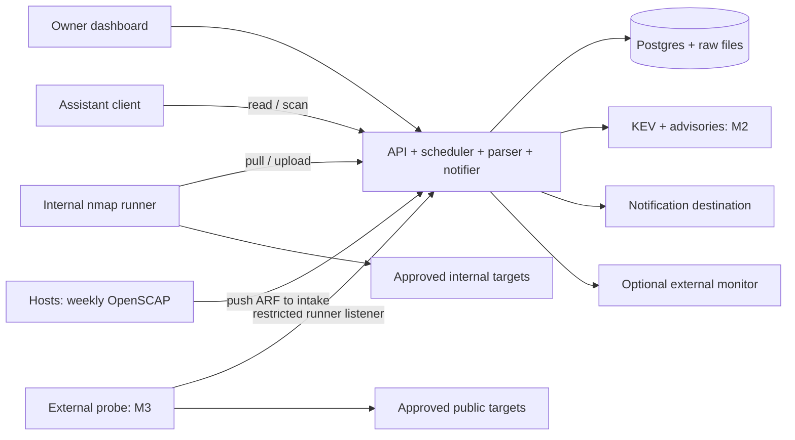

# Architecture

One Python service contains the FastAPI API, server-rendered dashboard, scheduler, parser, notifier, and later advisory matching. Postgres stores inventory, settings, intent, observations, jobs, findings, decisions, audit history, and notification retries. Compressed raw evidence lives in immutable files named by digest.

A pinned nmap container pulls assignments from a dedicated runner listener. Host deployment installs egress policy before execution: the runner waits until the host has stamped its current network namespace. The external probe uses the same protocol with its own identity and vantage.

Compliance is push-only. Each host evaluates pinned SCAP content with `oscap` on a weekly timer, generates an Ansible playbook from its own failures, and posts both to the intake, a third listener that accepts nothing but compliance uploads. `tailscale serve` puts the intake on its own tailnet port, so pen16 never connects to a host or holds a credential for one.

## API permissions

The dashboard and versioned API share application services. The dashboard is reachable only over Tailscale; `tailscale serve` passes the Tailscale identity, and pen16 allows the configured owner login. There are no passwords.

| Credential | Authority |
| --- | --- |
| Owner (Tailscale identity) | Read status; manage intent, settings, labels, decisions, and jobs |
| read | Read permitted inventory, findings, jobs, and sanitized evidence |
| scan | Request approved scans/verification for bound assets/profiles; inspect/cancel own requests |
| runner | Pull assigned jobs, upload their results, and report own heartbeat |
| compliance | Upload compliance results for its own host, named by the token, through the intake only |

An assistant client receives read and scan. Each request selects one registered asset, an approved profile, and a reason. Tokens cannot change intent, findings, scope, or deployment policy. Apply a simple per-token rate limit, initially six scan requests/hour. Return the API schema with permissions documented.

## Evidence flow

1. A schedule, owner, or permitted client requests work. Record targets, bindings, profile, vantage, requester, and deadline.
2. Split large work into bounded jobs. Validate scope at dispatch; the runner checks recipient, expiry, and local scope over authenticated TLS.
3. Store raw output durably before parsing and database finalization.
4. Commit observations, finding changes, and notification retry rows in a transaction.
5. Deliver grouped notifications and update dashboard freshness independently of finding counts.

A stale or duplicate upload can't overwrite newer state.

## Data rules

Observations record asset/address binding, protocol/port, vantage, time, tool/profile/parser versions, and evidence digest. Preserve detected, closed, filtered, unavailable, unsupported, failed, and cancelled outcomes. Missing output stays missing. Coverage includes the planned addresses/ports, including unresponsive addresses in routed ranges. L2 discovery requires an interface on that segment.

Gateway failure blocks negative conclusions for that network. Sleeping clients show availability gaps without repeated health alarms. Failed execution/parser work degrades schedule health. Positive evidence remains usable.

Settings, expected exposure, bindings, labels, and decisions have change history. Corrections preserve evidence. Findings are keyed by asset, service, check/advisory identity, and vantage. Automatic closure requires newer compatible closed-port evidence for every applicable binding. Internal results cannot close external findings. Manual resolution, intent changes, and asset retirement record their reasons. Filtered results follow [FR-6](SPEC.md#requirements).

Accepted-risk and false-positive decisions suppress notifications for their precise scope. Changed identity, product/version, severity/exploitation evidence, or vantage invalidates affected decisions. Unchanged observations update history quietly.

A compliance result belongs to a host and a benchmark. Rules are stored once per benchmark with their title, severity and references, and each result stores every rule's outcome, so the latest result per host and benchmark is the current state. A pass-to-fail change between a host's consecutive results is a regression; waivers are owner decisions about one rule on one host and record a reason. A checklist lists every rule of the imported DISA STIG release (its manual XCCDF, loaded with `pen16 stig-import`), with the status its SCAP rules give it: rules no SCAP rule checks stay not reviewed. Within a vulnerability ID, any failing rule makes the vulnerability open, all passing makes it not a finding, and all not-applicable makes it not applicable.

M2 matches explicit product identifiers/aliases and affected versions. Ambiguous versions remain potentially affected. Deduplicate by advisory and asset; retain source identity for non-CVE items. Feed disappearance and port closure leave advisory findings open.

## Jobs and notifications

Jobs are queued, running, succeeded, failed, or cancelled. Run one at a time per runner, with a 30-minute deadline and one automatic retry. Further failures wait for the next schedule or owner request. Cancellation stops reachable tool work within 10 seconds; local expiry stops disconnected execution. Discard expired assignments after restart.

Respect quiet windows. Manual pauses need explicit resume; resource pauses recover automatically. Show incomplete coverage separately from job status.

Group related alerts by asset/vantage over five minutes. Start with a short ntfy-compatible HTTP POST containing a summary and authenticated dashboard link.

| Delivery result | Retry behavior |
| --- | --- |
| Success | Mark delivered |
| Transient failure | Back off automatically, capped at one hour, for up to 24 hours |
| Permanent failure or retry exhaustion | Show failed delivery and one health incident; allow replay |

Alert after two missed/failed scheduled windows; gateway failure alerts immediately. M2 feed health degrades after two missed daily fetches. M3 heartbeats run every minute and alert after five minutes missing. An optional independent monitor receives a heartbeat while database, scheduler, and notification health pass.

## Deployment and state ownership

Use Compose and Ansible server/probe roles on existing Debian 13 hosts.

| State | Owner |
| --- | --- |
| Scope, exclusions, networking, ceilings, secret references, release pins | Private deployment repository; Ansible applies it |
| Assets, intent, settings, decisions, observations, enrollment, history | Database; dashboard edits routine settings |
| SCAP content pin, profiles, tailoring, and custom content per host | Private deployment repository; Ansible installs it on each host |
| Raw evidence | Immutable files included with database backups |

Ansible owns startup, interfaces, egress rules, private TLS, runtime secrets, and backup timers.

On the server, [deploy/compose.yaml](../deploy/compose.yaml) runs Postgres, the worker, the dashboard, the listener, the compliance intake, and the internal runner. The runner sits alone on a bridge with the listener and reaches targets through the host's NAT, so this release scans routed address lists without L2 discovery. The host's `pen16-egress` service loads [runner-egress.nft](../deploy/runner-egress.nft) into the runner's namespace on every start. On each scanned host, [deploy/compliance](../deploy/compliance) holds the `pen16-compliance` script and its weekly timer; the deployment installs it with the SCAP content, profile, tailoring and token for that host. The `pen16-backup` timer writes a verified nightly backup to an off-host mount the deployment provides. Scope/ceiling changes stop affected work until policy readiness passes. Deployment preserves dashboard settings. Restore uses database state. The owner provisions hosts separately.
