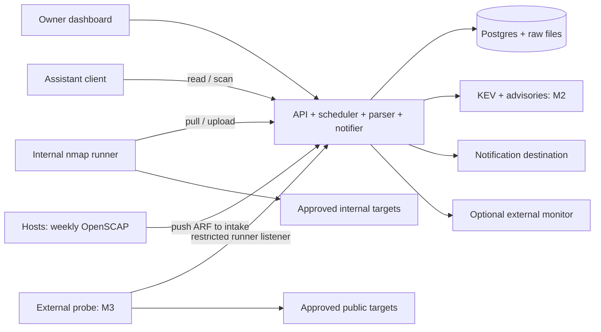

# Architecture

One Python service contains the FastAPI API, server-rendered dashboard, scheduler, parser, notifier, and later advisory matching. Postgres stores inventory, settings, intent, observations, jobs, findings, decisions, audit history, and notification retries. Compressed raw evidence lives in immutable files named by digest.

A pinned nmap container pulls assignments from a dedicated runner listener. Host deployment installs egress policy before execution: the runner waits until the host has stamped its current network namespace. The external probe uses the same protocol with its own identity and vantage.

Compliance is push-only. Each host evaluates pinned SCAP content with `oscap` on a weekly timer, generates an Ansible playbook from its own failures, and posts both to the intake, a third listener that accepts nothing but compliance uploads. `tailscale serve` puts the intake on its own tailnet port, so pen16 never connects to a host or holds a credential for one.

## API permissions

The dashboard and versioned API share application services. The dashboard is reachable only over Tailscale; `tailscale serve` passes the Tailscale identity, and pen16 allows the configured owner login. There are no passwords. The one exception is `/static`, the logo and web app manifest a browser tab or a phone's home screen uses, which holds nothing about the network and is served to anyone on the tailnet.

| Credential | Authority |
| --- | --- |
| Owner (Tailscale identity) | Read status; manage intent, settings, labels, decisions, and jobs |
| read | Read permitted inventory, findings, jobs, and sanitized evidence |
| scan | Request approved scans/verification for bound assets/profiles; inspect/cancel own requests |
| runner | Pull assigned jobs, upload their results, and report own heartbeat |
| compliance | Upload compliance results for its own host, named by the token, through the intake only |

An assistant client receives read and scan. Each request selects one registered asset, an approved profile, and a reason. Tokens cannot change intent, findings, scope, or deployment policy. Apply a simple per-token rate limit, initially six scan requests/hour. Return the API schema with permissions documented.

The runner listener and the compliance intake are the services other machines reach, so each logs in to the database as its own role with only the table privileges its requests use ([roles.py](../src/pen16/roles.py)): neither can read settings or schedules, change intent, waivers or token revocation, or touch the other's data. `pen16 migrate` creates the roles and resets their grants after every upgrade. The dashboard sits on a container network with only the database, so neither service can reach it to send identity headers.

## Evidence flow

1. A schedule, owner, or permitted client requests work. Record targets, bindings, profile, vantage, requester, and deadline.
2. Split large work into bounded jobs. Validate scope at dispatch; the runner checks recipient, expiry, and local scope over authenticated TLS.
3. Bound and parse raw output, then store it durably before database finalization. Output that doesn't parse fails the attempt and isn't kept.
4. Commit observations, finding changes, and notification retry rows in a transaction.
5. Deliver grouped notifications and update dashboard freshness independently of finding counts.

A stale or duplicate upload can't overwrite newer state.

## Data rules

Observations record asset/address binding, protocol/port, vantage, time, tool/profile/parser versions, and evidence digest. Preserve detected, closed, filtered, unavailable, unsupported, failed, and cancelled outcomes. A service last seen open that a scan sees closed gets a closed observation, under the gateway rule below, even when nmap only counted the port among its closed ones; that's how a service shows as removed. A scan also records which MAC answered at each up address, when the scanner host's neighbour table has one confirmed during the scan. Missing output stays missing. Coverage includes the planned addresses/ports, including unresponsive addresses in routed ranges. L2 discovery requires an interface on that segment.

Gateway failure blocks negative conclusions for that network. Sleeping clients show availability gaps without repeated health alarms. Failed execution/parser work degrades schedule health. Positive evidence remains usable.

Settings, expected exposure, bindings, labels, and decisions have change history. Each finding keeps every status change with who made it (the owner, or a scan and the observation that caused it) and why; expected services and waivers end with who ended them and why instead of being deleted. Corrections preserve evidence. Findings are keyed by asset, service, check/advisory identity, and vantage. Automatic closure requires newer compatible closed-port evidence for every applicable binding, and a scan reopens a resolved finding only with evidence newer than the observation it was resolved on. Internal results cannot close external findings. Manual resolution, intent changes, and asset retirement record their reasons. Filtered results follow [FR-6](SPEC.md#requirements).

Accepted-risk and false-positive decisions suppress notifications for their precise scope: one finding, so one asset, service and vantage. Each records the service, product and version it was decided on; a scan that reports a different one withdraws it with what changed, and the finding alerts and returns to needs attention. A field the scan didn't report isn't a change. A new vantage is a separate finding with no decision. Severity/exploitation evidence will invalidate decisions too, with advisories. Only named assets take decisions, and a device keeps its own: see identity below. Withdrawn decisions stay as history. Unchanged observations update history quietly.

A binding puts one device at an address and records the MAC that answers there, learned from the first scan that sees one. A scan that sees a different MAC at a bound address gives the address to a new provisional device before recording anything, so the old device's expected services and decisions don't apply to the newcomer, and the newcomer's closed ports resolve nothing of the old device's; the change alerts. Where either MAC is private, which a device can change on its own, the dashboard asks whether the newcomer is the same device: naming it after the old one merges them, and where both have a finding for one service, the newer evidence decides its state and both histories stay. Retiring a device ends its bindings, expected services and decisions, resolves its open findings, and revokes its compliance tokens, each with the owner's reason; the next device at its address is a new provisional one. The owner can also move a named device's address to another named device, with a reason: only what's seen there afterwards is the other device's, and what's already recorded stays with the device it was recorded for. A device that loses its address keeps its open findings open, because missing coverage resolves nothing, but drops out of the exposure view, which shows only what's reachable now. Provisional IDs are never reused, and every binding change is history. An address no MAC answers for, such as a routed network's, is identified by address alone.

A compliance result belongs to a host and a benchmark. Rules are stored once per benchmark with their title, severity and references, and each result stores every rule's outcome, so the latest result per host and benchmark is the current state. A compliance host is a named asset with no address until the owner names a scanned device after it, which joins the two; a name another device holds is refused. A pass-to-fail change between a host's consecutive results is a regression; waivers are owner decisions about one rule on one host and record a reason. A checklist lists every rule of the imported DISA STIG release (its manual XCCDF, loaded with `pen16 stig-import`), with the status its SCAP rules give it: rules no SCAP rule checks stay not reviewed. Within a vulnerability ID, any failing rule makes the vulnerability open, all passing makes it not a finding, and all not-applicable makes it not applicable.

M2 matches explicit product identifiers/aliases and affected versions. Ambiguous versions remain potentially affected. Deduplicate by advisory and asset; retain source identity for non-CVE items. Feed disappearance and port closure leave advisory findings open.

## Jobs and notifications

Jobs are queued, running, succeeded, failed, or cancelled. Run one at a time per runner, with a 30-minute deadline and one automatic retry. Further failures wait for the next schedule or owner request. Cancellation stops reachable tool work within 10 seconds; local expiry stops disconnected execution. Discard expired assignments after restart.

Respect quiet windows. Manual pauses need explicit resume; resource pauses recover automatically. Show incomplete coverage separately from job status.

Group related alerts by asset/vantage over five minutes. Start with a short ntfy-compatible HTTP POST containing a summary and authenticated dashboard link.

| Delivery result | Retry behavior |
| --- | --- |
| Success | Mark delivered |
| Transient failure | Back off automatically, capped at one hour, for up to 24 hours |
| Permanent failure or retry exhaustion | Show failed delivery and one health incident; resend from the dashboard, with a fresh 24 hours |

Problems with monitoring itself are incidents, one per subject: a network's gateway, a schedule, backups, a compliance host, alert delivery, a background task. Opening one alerts once, clearing it sends one recovery notice, and the open ones show under monitoring health; cleared ones stay as history. The worker runs each background task on its own, so one that keeps failing opens its incident while the rest, alert delivery included, go on; the dashboard shows when the worker last finished a round. A scheduled scan alerts after two missed/failed windows in a row, and a requested one shows its failure on the dashboard only; gateway failure alerts immediately. M2 feed health degrades after two missed daily fetches. M3 heartbeats run every minute and alert after five minutes missing. An optional independent monitor receives a heartbeat while database, scheduler, and notification health pass.

## Deployment and state ownership

Use Compose and Ansible server/probe roles on existing Debian 13 hosts.

| State | Owner |
| --- | --- |
| Scope, exclusions, networking, ceilings, secret references, release pins | Private deployment repository; Ansible applies it |
| Assets, intent, settings, decisions, observations, enrollment, history | Database; dashboard edits routine settings |
| SCAP content pin, profiles, tailoring, and custom content per host | Private deployment repository; Ansible installs it on each host |
| Raw evidence | Immutable files included with database backups |

Ansible owns startup, interfaces, egress rules, private TLS, runtime secrets, and backup timers.

On the server, [deploy/compose.yaml](../deploy/compose.yaml) runs Postgres, the worker, the dashboard, the listener, the compliance intake, and the internal runner. The runner sits alone on a bridge with the listener and reaches targets through the host's NAT, so this release scans routed address lists without L2 discovery. The host's `pen16-neighbours` service writes its neighbour table to `/run/pen16-neighbours`, which the listener mounts read-only to record each up target's MAC ([ADR-009](stack.md#adr-009-mac-addresses-from-the-scanner-hosts-neighbour-table)); only addresses on the host's own segment have one. The host's `pen16-egress` service loads [runner-egress.nft](../deploy/runner-egress.nft) into the runner's namespace on every start. On each scanned host, [deploy/compliance](../deploy/compliance) holds the `pen16-compliance` script and its weekly timer; the deployment installs it with the SCAP content, profile, tailoring and token for that host. The `pen16-backup` timer writes a verified nightly backup to an off-host mount the deployment provides. Scope/ceiling changes stop affected work until policy readiness passes. Deployment preserves dashboard settings. Restore uses database state. The owner provisions hosts separately.
