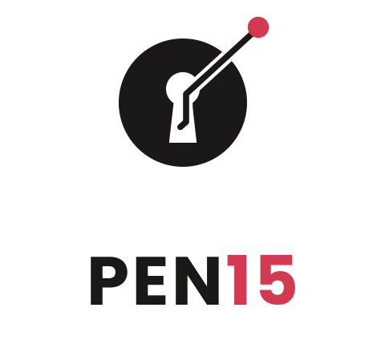

  <picture>
    <source media="(prefers-color-scheme: dark)" srcset="assets/pen15-lockup-dark.svg">
    
  </picture>

# pen15

**Find the holes before they do.**

Self-hosted attack-surface monitoring for networks you own. Scheduled internal and external scans, history and diffs over time, threat-intel matching, and AI triage that hands remediation and testing playbooks to a human.

> **Status:** design phase. See [SPEC.md](SPEC.md) and [ARCHITECTURE.md](ARCHITECTURE.md).

## Responsible use

pen15 is for assessing networks and systems you own or are explicitly authorized to test. Every scan is checked against a scope allowlist you define, and nothing runs against targets outside it. Scanning systems without permission is illegal in most places; don't.

## License

Apache-2.0. See [LICENSE](../LICENSE) and [NOTICE](../NOTICE).
